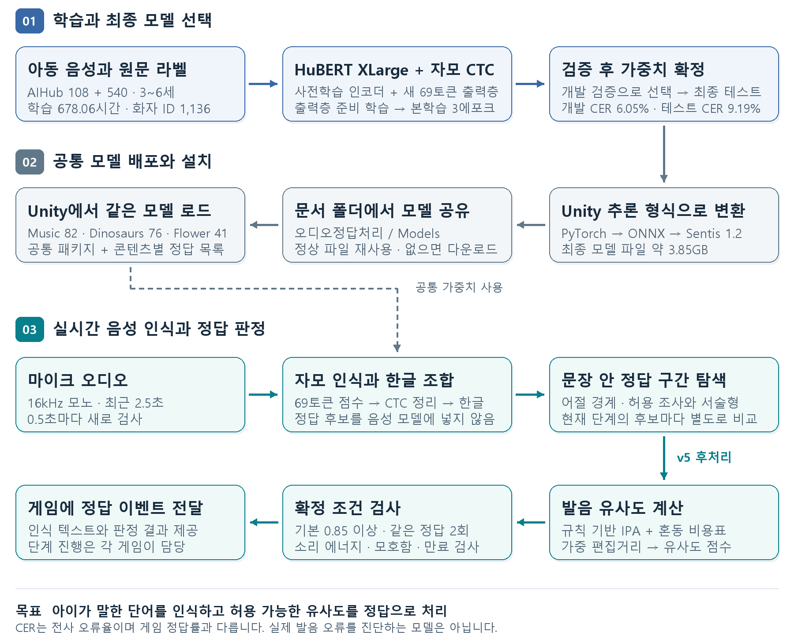
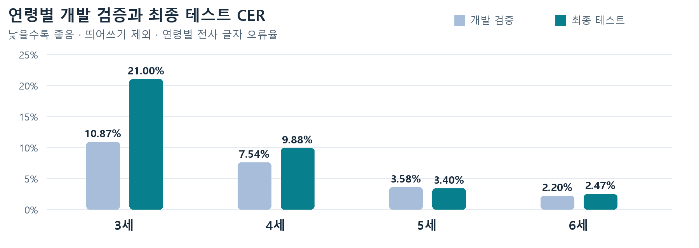

# 아동 음성 인식 모델과 정답 판정 구조

기준일: **2026-11-02**. 최종 3에포크 모델과 공개 배포 패키지 **0.9.0-preview.1** 기준입니다.

[한글 보고서 · 9쪽](reports/model-20261102/model-report-ko.hwp) · [전체 파이프라인](reports/model-20261102/pipeline.png) · [최종 모델·패키지 Release](https://github.com/rnrdus5642/Audio-Recognition/releases/tag/model-v4-child-jamo-epoch3-sentis1)

한국어 HuBERT XLarge를 3~6세 아동 음성으로 파인튜닝하고, 문장 속 정답 단어를 판정하는 후처리를 결합했습니다. 같은 모델과 패키지를 악기 연주하기·공룡알 키우기·식물 키우기에서 공유합니다.

그림 1  데이터 선별부터 학습과 배포를 거쳐 실제 게임의 정답 이벤트가 발생하는 전체 흐름

**학습 678.06시간   ·   화자 ID 1,136개   ·   자모 69토큰   ·   본학습 3에포크**

이 문서는 실제 학습 목록, 최종 평가 파일과 현재 배포 패키지를 기준으로 작성했습니다. 과거 모델의 실험 수치와 최종 모델의 성능을 구분하며, 음성 인식 성능과 게임 정답 판정 성능을 따로 설명합니다.

## 기반 모델과 입력 출력

사전학습된 한국어 음성 표현을 아동의 발화 특성에 맞추고, 정답 단어의 원래 표기를 자모 단위로 예측합니다. 연령이나 콘텐츠별로 모델을 분리하지 않습니다.

| 항목 | 현재 모델 |
| --- | --- |
| 기반 모델 | team-lucid/hubert-xlarge-korean |
| 구조와 규모 | 7층 CNN + 48층 Transformer · 약 10억 파라미터 |
| Transformer 내부 | 특징 차원 1,280 · 어텐션 헤드 16개 |
| 입력 음성 | 16kHz 모노 PCM · float32로 변환 |
| 출력층 | 새로 초기화한 1,280 → 69 CTC 출력층 |
| 토큰 구성 | 초성 19 + 중성 21 + 종성 27 + 공백 1 + blank 1 |
| 학습 정답 | 원문 단어 표기를 유지한 전사를 Unicode NFD 자모로 분해 |
| 텍스트 복원 | 프레임별 예측 → CTC 반복·blank 정리 → NFC 한글 조합 |
| 현재 Unity 입력 | 40,000샘플인 최근 2.5초를 0.5초 간격으로 검사 |

### 학습 목표와 제품 목표

아이가 “짹”에 가깝게 말했더라도 데이터셋 라벨이 “책”이면 모델은 “책”을 출력하도록 학습될 수 있습니다. 현재 목표는 아이가 말하려는 단어를 인식해 게임 정답으로 처리하는 것입니다. 음성의 실제 발음 기호를 정확하게 받아쓰거나 발음 장애를 진단하는 기능은 제공하지 않습니다.

### 음성 인식과 정답 목록의 관계

정답 후보는 음성 모델의 입력에 들어가지 않습니다. 모델은 먼저 음성을 독립적으로 받아쓰고, 후처리가 현재 단계의 정답 후보 각각과 비교합니다. 한 번의 음성 추론 결과를 여러 후보가 공유하므로 후보 수만큼 신경망을 반복 실행하지 않습니다.

### 표현 가능한 단어와 학습된 단어

69개 토큰의 조합으로 현대 한글 11,172개 음절을 구조적으로 표현할 수 있습니다. 기존 완성형 글자 어휘에서 빠진 글자 때문에 출력이 막히는 문제를 줄였지만, 학습에서 드문 단어의 인식 정확도까지 보장하지는 않습니다. 종성 ㄽ과 ㄿ은 어휘에는 있지만 실제 학습 라벨에서는 관측되지 않았습니다.

근거  [1] 공개 모델 · [4] 학습 설정 · [6] 최종 배포 모델 식별 정보

## 학습 데이터와 연령 분포

다운로드 원본 전체가 아니라, 품질·태그·연령 조건을 적용한 뒤 실제 학습 목록에 남은 데이터를 집계했습니다. 연령은 원본 메타데이터 기준입니다.

| 원본 데이터셋 | 연령 | 화자 ID | 발화 수 | 학습 시간 |
| --- | --- | --- | --- | --- |
| AIHub 540 한국어 아동 음성 | 4~6세 | 489 | 222,458 | 297.21시간 |
| AIHub 108 자유대화 음성 | 3~6세 | 647 | 417,810 | 380.85시간 |
| 학습 합계 | 3~6세 | 1,136 | 640,268 | 678.06시간 |

### 학습용 음성의 연령별 구성

| 연령 | 화자 ID | 발화 수 | 시간 | 시간 비중 |
| --- | --- | --- | --- | --- |
| 3세 | 59 | 16,772 | 16.34시간 | 2.4% |
| 4세 | 173 | 75,224 | 77.51시간 | 11.4% |
| 5세 | 358 | 198,697 | 210.57시간 | 31.1% |
| 6세 | 546 | 349,575 | 373.64시간 | 55.1% |

6세 학습 음성은 3세의 약 23배입니다. 3세 자료는 모두 AIHub 108에서 왔으므로, 연령 효과와 발화·수집 방식의 효과를 완전히 분리하기 어렵습니다.

| 용도 | 화자 ID | 발화 수 | 시간 |
| --- | --- | --- | --- |
| 학습 | 1,136 | 640,268 | 678.06시간 |
| 개발 검증 | 212 | 120,653 | 139.21시간 |
| 최종 테스트 | 209 | 118,603 | 132.85시간 |
| 전체 | 1,557 | 879,524 | 950.12시간 |

### 분할과 선별 기준

화자 ID를 기준으로 학습·개발 검증·테스트를 분리했으며 분할 간 동일 ID와 동일 PCM 중복을 검사했습니다. 두 원본 데이터셋에 같은 아동이 존재하는지는 확인되지 않아 중복이 없다고 가정했습니다. 따라서 화자 수는 신원이 확인된 실인원과 완전히 같은 의미는 아닙니다.

(NO:)·(SP:) 등 특수 태그를 포함한 38,479개 발화를 문장째 제외했고, 학습용 20초 초과 발화 25개도 제외했습니다. 그 밖의 선별 조건을 통과한 발화는 앞뒤·중간 무음을 일괄 자르지 않고 사용했습니다. 직접 녹음한 테스트 파일은 위 학습량에 포함하지 않았습니다.

근거  [2] AIHub 원본 설명 · [3] 실제 학습 목록 재집계

## 학습 설정과 소요 시간

새 출력층을 먼저 적응시킨 뒤, 사전학습 인코더와 함께 본학습을 수행했습니다. 에포크는 누적 처리 음성 시간을 학습 데이터 시간으로 나눈 상당량으로 계산했습니다.

| 항목 | 실제 실행 설정 |
| --- | --- |
| 출력층 준비 학습 | 인코더 고정 · CTC 출력층만 1,000회 업데이트 |
| 본학습 범위 | 초기 CNN 고정 · Transformer와 특징 투영층 및 출력층 학습 |
| 본학습 분량 | 3.0에포크 · 누적 음성 약 2,034.18시간 |
| 배치 구성 | 길이별 동적 배치 · 패딩 포함 20초 예산 · 최대 32발화 |
| 기울기 누적 | 미니배치 16개를 모아 한 번 업데이트 |
| 기본 학습률 | 준비 출력층 0.001 · 본학습 인코더 0.00002 / 출력층 0.0001 |
| 최적화 | AdamW · BF16 혼합정밀도 · CPU로 일부 상태 분산 |
| 장비 | RTX 5060 Ti 16GB · CPU 스레드 8개 |
| 중단 복구 저장 | 100회 업데이트 또는 약 10분마다 상태 저장 |

### 중간 비교 실험과 최종 선택

약 1에포크 시점에서 원래 연령 분포와 저연령 보강 분포를 각각 200시간씩 추가 학습했습니다. 보강 분포의 개발 검증 평균 CER은 7.62%로 원래 분포의 7.94%보다 낮았지만, 3세 CER 상대 개선폭이 채택 기준 5%에 조금 못 미쳐 원래 분포를 유지했습니다. 사전 조건 6개 중 5개를 만족한 결과이며, 보강 학습이 불리하다는 증거는 아닙니다.

최종 선택 체크포인트는 업데이트 29,430의 candidate_age3입니다. 이름과 달리 3세 전용 모델이 아닙니다. 업데이트 번호에는 준비 학습과 비교 실험이 포함되어 있습니다. 본학습 후반 약 2.4에포크부터 학습률을 낮추며 종료했습니다.

| 시간 집계 기준 | 소요 시간 |
| --- | --- |
| 학습 업데이트 측정 시간 · 비교 실험 포함 | 약 61시간 49분 |
| 검증과 저장을 포함한 실행 누적 시간 | 약 73시간 36분 |
| 일시정지를 포함한 전체 경과 시간 | 약 88시간 29분 |

2026년 10월 27일 14시 53분경 시작했습니다. 최종 가중치는 10월 31일 02시 22분경 저장했고, 최종 테스트까지 끝난 시점은 10월 31일 07시 22분경입니다. 저장에는 가중치뿐 아니라 옵티마이저·샘플러·난수 상태를 포함해 중단 후 이어서 학습할 수 있게 했습니다.

근거  [4] contract.json · progress.json · selection.json · events.jsonl

## 최종 음성 인식 성능

개발 검증으로 모델을 선택한 뒤, 별도로 분리한 209개 화자 ID의 132.85시간 음성에서 최종 테스트를 수행했습니다. 아래 수치는 후처리를 적용한 게임 정답률이 아니라 전사 오류율입니다.

| 연령 | 개발 검증 CER | 최종 테스트 CER | 테스트 화자 ID | 테스트 시간 |
| --- | --- | --- | --- | --- |
| 3세 | 10.87% | 21.00% | 7 | 0.90시간 |
| 4세 | 7.54% | 9.88% | 22 | 12.58시간 |
| 5세 | 3.58% | 3.40% | 63 | 34.38시간 |
| 6세 | 2.20% | 2.47% | 117 | 84.99시간 |
| 동일 비중 평균 | 6.05% | 9.19% | 209 합계 | 132.85시간 합계 |

### CER 계산과 평균의 의미

CER = 바뀐 글자 수와 빠진 글자 수와 추가된 글자 수의 합 ÷ 정답 글자 수. 한글을 완성형으로 조합하고 띄어쓰기를 제외해 계산합니다. 각 연령의 CER에 25%씩 동일한 비중을 주므로 자료가 적은 3세 성능도 평가에 반영됩니다.

모든 글자를 한꺼번에 합산한 CER은 3.73%입니다. 이 값은 자료가 많은 5~6세에 크게 영향을 받습니다. 연령 평균 CER 9.19%를 게임 정답률 90.81%로 바꾸어 해석할 수는 없습니다.

### 평가 범위와 남은 불확실성

3세 테스트는 7개 화자 ID와 약 54분 분량으로 작고 CER도 21.00%로 높습니다. 개발 검증과 테스트 간 차이는 화자와 발화 특성 차이의 영향도 받을 수 있으므로 과적합만으로 단정하지 않습니다. 빈 문자열이 아닌 출력 비율 99.98%는 발화가 있는 자료의 수치이며 무음 판정 성능을 뜻하지 않습니다.

근거  [5] 개발 검증 및 최종 테스트 원본 결과

## 정답 판정 후처리의 동작

현재 정책은 orthographic-word-context-v5입니다. 앞뒤 말이 정답 단어의 점수를 깎지 않도록, 문장 전체와 비교하는 대신 적절한 단어 구간을 찾아 점수를 계산합니다.

### 음성 입력과 후보 구간 탐색

최근 2.5초를 0.5초마다 받아쓰고 인식 문장을 보존합니다. 띄어쓰기 경계를 기준으로 문장 중간까지 살펴보며 명시적으로 등록한 조사·서술형·인용 표현을 처리합니다. 끝의 물음표 같은 문장부호는 비교 시 정리합니다. 정답 목록은 이 단계에서만 사용합니다.

### 발음 유사도와 혼동 비용표

선택한 텍스트 구간과 후보를 규칙 기반 한국어 발음 기호로 변환합니다. ko_child_v2 혼동 비용표로 소리의 치환·탈락·추가 비용을 다르게 주는 가중 편집거리를 계산하고, 정답 발음 길이를 기준으로 유사도를 만듭니다. 길이 차이가 지나치면 추가 보정합니다. 별도 신경망 IPA 모델을 설치하지 않습니다.

### 통과 임계값과 시간 조건

기본 기준은 유사도 0.85 이상이며 같은 정답을 두 번 확인해야 합니다. 확인 사이에 불확실한 검사 한 번을 허용하고 오래된 기록은 만료시킵니다. 기본 시간 간격에서는 약 1.25초를 넘긴 기록을 유지하지 않습니다. 0.85는 정답 확률이 아니라 설정한 유사도 기준입니다.

### 오통과를 줄이는 규칙

소리 에너지가 부족한 입력, 모호한 동점 후보, 알려진 다른 동작 계열, 일부 부정 표현 등을 검사합니다. 한 음절 정답을 문장 중간에서 찾을 때는 발음 기호 일치를 요구합니다. 에너지 검사는 잡음 제거 또는 화자 분리 기능이 아닙니다.

| 입력 예시와 상황 | 현재 처리 원칙 |
| --- | --- |
| 이건 사과인 것 같아요 | 허용된 접사 처리 후 사과 구간 비교 |
| 사과주스 | 임의로 단어 내부를 잘라 사과로 인정하지 않음 |
| 사과 주스 또는 중간 출력 사과 | 띄어쓰기나 실시간 중간 결과 때문에 통과할 여지가 있음 |
| 들까요? | 물음표는 표시용으로 유지하고 비교에서는 정리 |
| 다른 말 때문에 사과를 다르게 받아씀 | 후처리만으로 원래 음성을 복원할 수 없음 |

글자 길이의 1.2~1.5배 범위 실험은 했지만, 최종 적용 방식은 단순 글자 수 자르기보다 어절 경계와 허용 접사 규칙을 사용합니다. 음성 모델에 넣는 창 길이는 현재도 2.5초입니다.

근거  [7] Python 후처리와 Unity 공통 정책 구현

## 후처리 시험 결과와 제품 한계

전사 CER과 실제 정답 통과율은 따로 검증해야 합니다. 아래는 개발용 음성을 재사용한 회귀 시험이며, 새 아동 집단에서의 독립적인 현장 정확도 측정은 아닙니다.

| 시험 조건 | 현재 결과 | 해석 |
| --- | --- | --- |
| 정답이 포함된 자연 문장 | 145 / 165 | 통과율 87.9% 이전 71.5%에서 개선 |
| 정답 단어만 재생 | 62 / 102 | 통과율 60.8% 단계별 후보 목록 사용 |
| 다른 말 바로 뒤에 정답 연결 | 49 / 102 | 통과율 48.0% |
| 잡음 뒤에 정답 연결 | 59 / 102 | 통과율 57.8% |
| 정답 없는 다른 문장 | 17 / 1,080 | 오통과율 1.57% |
| 60초 무관한 말소리 | 6 / 27 | 오통과율 22.2% |
| 60초 무음·백색잡음·험과 클릭음 | 각 0 / 27 | 해당 시험에서 오통과 없음 |

### 숫자를 해석할 때의 조건

동일한 녹음을 여러 조건 및 단계별 정답 목록과 조합했습니다. 27건은 아동 27명을 따로 시험했다는 뜻이 아닙니다. 시험 묶음의 난도와 구성도 다르므로 하나의 전체 정답률로 합산하지 않습니다. 일부 별도 텍스트 템플릿 검사는 음성 인식 성능으로 집계하지 않습니다.

### 확인된 개선과 남은 문제

모델이 문장 속 정답을 제대로 받아썼을 때, 앞뒤 말 때문에 판정에서 탈락하는 경우는 줄었습니다. 반면 앞의 다른 말 때문에 음성 모델이 정답을 잘못 받아쓰는 경우는 여전히 남아 있습니다. 주변 사람과 아이의 목소리를 구분하는 화자 분리 기능도 없습니다.

### 다음 평가의 우선순위

① 3세 아동의 실제 게임 단어와 발화 다양성을 늘려 확인합니다. ② 같은 정답의 단독 발화와 앞뒤 말이 붙은 발화를 짝지어 시험합니다. ③ 무관 발화·주변 사람의 말·한 음절 정답의 오통과를 따로 집계합니다. ④ 후처리 조정용 자료와 최종 제품 평가 자료를 분리합니다.

현재 결과만으로 “3에포크가 모든 단어에서 더 좋다”거나 “정답 목록의 모든 표현이 안정적으로 통과한다”고 단정하지 않습니다. 다음 개선은 에포크 추가보다 이 조건들에서의 원인별 평가를 먼저 수행하는 편이 근거가 분명합니다.

근거  [8] 후처리 비교 시험 원본과 한계 기록

## Unity 적용과 실행 자원

세 콘텐츠는 동일한 추론 모델과 후처리 패키지를 사용합니다. 정답 목록과 단계 진행 로직은 각 프로젝트에 남아 있으며, 파일 설치와 음성 인식은 공통 패키지가 담당합니다.

| 프로젝트 | 단계 | 정답 표현 | 공통 패키지 |
| --- | --- | --- | --- |
| Music 악기 연주하기 | 9 | 82개 | 0.9.0-preview.1 |
| Dinosaurs 공룡알 키우기 | 9 | 76개 | 0.9.0-preview.1 |
| Flower 식물 키우기 | 9 | 41개 | 0.9.0-preview.1 |

단계 간 중복 표현을 포함한 개수입니다. Unity 2022.3 / Sentis 1.2.0-exp.2 / Windows PC 및 PC 연결 VR을 대상으로 적용했습니다.

### 공용 모델 설치와 앱 시작

개발자는 Tools → 오디오 정답 처리 기능 → 초기 세팅을 실행합니다. 문서 폴더에서 정상 파일을 재사용하고, 파일이 없으면 다운로드합니다. 같은 메뉴의 음성 테스트와 정답 단어 설정을 사용하며 단어 추가에 재학습은 필요하지 않습니다.

문서\오디오정답처리\Models\
hubert_ko_child_jamo_epoch3_sentis1.sentis

모델은 약 3.85GB이며 빌드 실행 파일에는 포함하지 않습니다. 앱의 시작 씬에서 설치 상태를 확인하고 필요하면 내려받은 뒤 게임 씬을 엽니다. 정상 설치 이후에는 크기·수정 시각·검증 표식을 확인하며 매번 전체 해시를 다시 계산하지 않습니다. 기능 사용자에게 Unity·Python·별도 음성 서버 설치는 필요하지 않습니다.

| RTX 5060 Ti에서 측정한 항목 | 결과 |
| --- | --- |
| 모델 로드 | 약 0.97초 |
| 첫 추론 | 약 1.39초 |
| 준비 후 2.5초 음성 추론 중앙값 | 약 64ms |
| 준비 후 추론 p95 | 약 64.6ms |
| 검증 중 그래픽 메모리 할당 계측 | 약 3.9GB |

Unity Editor에서 측정한 값으로 전체 게임의 VRAM 사용량이나 모든 PC의 속도를 뜻하지 않습니다. 실제 확정 지연에는 0.5초 검사 간격과 2회 확인도 영향을 줍니다. 현재 패키지는 GPUCompute를 사용하며 CPU 자동 전환과 최종 모델의 CPU 속도 검증은 포함되어 있지 않습니다.

후처리 코드를 바꾸면 패키지 갱신과 앱 재빌드가 필요합니다. 가중치가 같으면 큰 모델 파일을 다시 받을 필요는 없습니다. 새 콘텐츠도 공통 모델을 재사용하고 자체 정답 목록과 게임 이벤트를 연결하면 됩니다.

근거  [9] 패키지 README · [10] 프로젝트 적용 및 GPU 검증 기록

## 모델 식별 정보와 근거 자료

문서의 수치는 다음 원본 기록으로 추적할 수 있습니다. 공개 데이터셋 전체 규모와 이번에 선별한 학습량을 구분했으며, 화자 ID나 개별 아동의 식별 정보는 본문에 포함하지 않았습니다.

| 식별 항목 | 값 |
| --- | --- |
| 기반 모델 | team-lucid/hubert-xlarge-korean |
| 최종 체크포인트 | ckpt-000029430-089b46152acd.pt |
| 최종 선택 | candidate_age3 · 전체 3~6세 공통 모델 |
| Unity 모델 파일 | hubert_ko_child_jamo_epoch3_sentis1.sentis |
| 정답 정책 | orthographic-word-context-v5 |
| 패키지 | com.domicube.phoneme-matching 0.9.0-preview.1 |

### 공개 원본

[1] 한국어 HuBERT 공개 모델

- [한국어 HuBERT 모델](https://huggingface.co/team-lucid/hubert-xlarge-korean)

[2] AIHub 한국어 아동 음성 540 및 자유대화 음성 108

- [AIHub 한국어 아동 음성 540](https://aihub.or.kr/aihubdata/data/view.do?dataSetSn=540)
- [AIHub 자유대화 음성 108](https://www.aihub.or.kr/aihubdata/data/view.do?dataSetSn=108)

### 프로젝트 내부 기록

아래 경로는 바탕화면 Audio-Recognition 프로젝트를 기준으로 합니다. 실험 루트는 04_Models_and_Experiments/orthographic-jamo-20261027입니다.

[3] 실제 학습 목록 재집계

- `99_Organization/model-analysis-20261102/actual-training-data.json`

[4] 학습 설정과 진행 및 모델 선택

- `실험 루트/main/contract.json · progress.json · selection.json · events.jsonl`

[5] 최종 평가 원본

- `실험 루트/main/evaluations/final-test.json`
- `실험 루트/main/evaluations/candidate-2d837df5363f43ce1d67.json`

[6] 배포 모델 식별 정보

- `실험 루트/releases/Unity-final-v5-20261031/model-identity.json`

[7] 후처리 코드

- `01_Project/python/tools/child_orthographic_web/word_game.py`
- `01_Project/python/tools/child_orthographic_web/answer_policy.py`
- `01_Project/shared/confusion_matrices/ko_child_v2.json`

[8] 후처리 시험 결과

- `실험 루트/web-test/context-policy-20261031/summary.json`

[9] Unity 설치와 사용 설명

- `01_Project/unity-distribution/com.domicube.phoneme-matching/README.md`

[10] 세 프로젝트 적용 및 GPU 실측

- `실험 루트/releases/Unity-final-v5-20261031/project-application/completed.json`
- `실험 루트/releases/Unity-final-v5-20261031/sentis1-gpu-validation.json`

## 배포 파일 식별과 기록의 범위

- 최종 선택 가중치 ID: `2d837df5363f43ce1d67fd31da57b66db603b9b31d3920b30cdc79479adc45a3`.
- Sentis 파일 크기: `3,851,161,113 bytes`.
- Sentis SHA-256: `1ce1f13e3497844a6632cae3d6925f3aae64159f6d5ab2b60c84613493dcbea3`.
- 패키지 파일: `com.domicube.phoneme-matching-0.9.0-preview.1.tgz`.
- 패키지 SHA-256: `a83c22a51126e20d576634388b083c47fce0694c548fc56603892deeb8f9239d`.

위 내부 경로의 학습 기록·평가 원본·가중치·녹음은 로컬 보관 자료입니다. Git clone에는 포함되지 않습니다. 공개 배포물은 위 Release에서 내려받습니다. 이 문서와 HWP·도식은 같은 보고서 내용을 공유하며, HWP는 한글에서 다시 열어 9쪽을 확인하고 렌더링한 모든 페이지의 배치와 텍스트 누락을 검사했습니다.

프로젝트 적용 기록 [10]은 패키지 적용 당시의 검사입니다. 그 뒤의 게임별 Windows 빌드와 공룡 게임 초기화 수정은 각 Unity 프로젝트의 별도 이력이며, 이 보고서의 음성 모델 성능 수치와 구분합니다.
