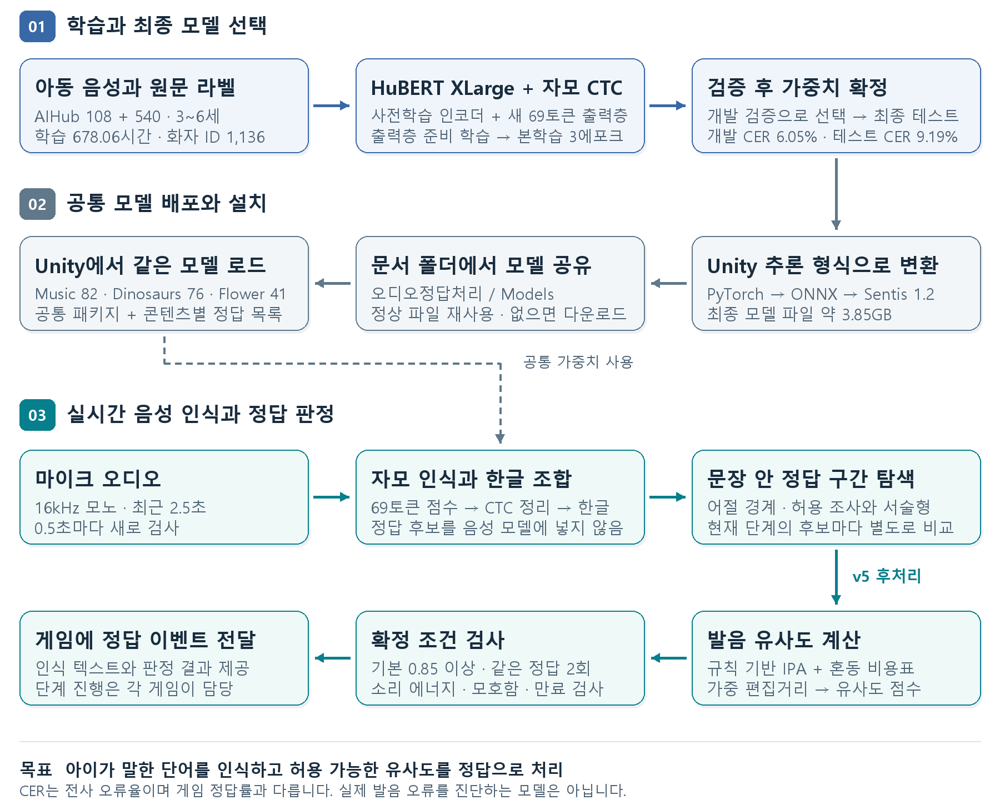

# Audio-Recognition

한국어 **3~6세 아동**의 발화를 인식하고, 현재 게임 단계의 정답 단어와 충분히 가까우면 통과시키는 프로젝트입니다.
현재 공개 배포 기준은 **최종 3에포크 HuBERT 자모 모델 + 문맥 후처리 v5 + Unity 패키지 0.9.0-preview.1**입니다.
학습과 최종 테스트는 2026-10-31에 완료했습니다. 문서 기준일은 2026-11-02입니다.

## 전체 구조와 보고서

- [전체 기술 보고서](01_Project/docs/CHILD_ORTHOGRAPHIC_MODEL_2026-11-02.md): 기반 모델, 데이터셋, 연령·화자·시간, 학습, 성능, 후처리, Unity 적용.
- [편집 가능한 한글 보고서 · 9쪽](01_Project/docs/reports/model-20261102/model-report-ko.hwp).
- [최종 모델과 Unity 설치 패키지](https://github.com/rnrdus5642/Audio-Recognition/releases/tag/model-v4-child-jamo-epoch3-sentis1).

| 항목 | 현재 배포 기준 |
|---|---|
| 기반 모델 | `team-lucid/hubert-xlarge-korean`, 약 10억 파라미터 |
| 입력·출력 | 16kHz 모노 음성 → 69종 자모 CTC → 조합된 한글 |
| 학습 데이터 | AIHub 108 + 540, 3~6세, 640,268발화·678.06시간·화자 ID 1,136개 |
| 학습 방식 | 원래 철자 라벨을 NFD 자모로 분해, 출력층 적응 후 본학습 3에포크 |
| 최종 성능 | 개발 검증 평균 CER 6.05%, 별도 테스트 평균 CER 9.19% |
| 후처리 | `orthographic-word-context-v5`, 문장 속 단어 구간별 발음 유사도 비교 |
| 실시간 검사 | 최근 2.5초를 0.5초마다 검사, 기본 유사도 0.85·같은 정답 2회 확인 |
| 적용 콘텐츠 | Music 82개 / Dinosaurs 76개 / Flower 41개 표현, 각각 9절차 |
| 실행 | Unity 2022.3 + Sentis 1.2 GPUCompute, Windows PC·PC 연결 VR |

CER은 연령별 동일 비중 평균이며 게임 정답 통과율이 아닙니다. 3세의 최종 테스트 CER은 21.00%입니다.
실제 발음을 정밀하게 전사하거나 발음 오류를 진단하는 모델은 아닙니다. 정답 후보는 모델 입력이 아니라 후처리에 사용합니다.
데이터셋 간 같은 아동의 중복 여부는 확인할 수 없어, 화자 수는 데이터셋별 ID를 합산한 값입니다.

## Unity에서 사용

공개 Release의 `com.domicube.phoneme-matching-0.9.0-preview.1.tgz`를 설치한 뒤
`Tools > 오디오 정답 처리 기능 > 초기 세팅`을 실행합니다.
같은 메뉴의 **음성 테스트**와 **정답 단어 설정**을 사용합니다. IPA용 추가 모델은 필요 없습니다.

모델은 현재 Windows 사용자의 **문서/오디오정답처리/Models**에 약 3.85GB 파일 한 개로 설치되며,
같은 버전을 쓰는 콘텐츠들이 공유합니다. 빌드 앱은 시작 화면에서 정상 파일을 재사용하고 없으면 설치합니다.
모델은 앱에 포함되지 않으며 기능 사용자에게 Unity·Python·별도 음성 서버 설치가 필요하지 않습니다.
후처리나 패키지를 바꾸면 앱을 다시 빌드해야 합니다.

## 로컬 실험과 폴더

이 PC의 최종 모델 웹 테스트는 로컬 `05_Run/start_orthographic_test.ps1`로 실행하며 주소는
<http://127.0.0.1:8782/>입니다. 웹 실험에는 로컬 Python 환경과 최종 모델 번들이 필요합니다.
기존 `start_microphone.ps1`의 7860 웹은 비교용 이전 글자 모델입니다.
[실행 안내](05_Run/README.md), [현재 모델과 보존 실험](04_Models_and_Experiments/README.md)을 참고하세요.

| 폴더 | 내용 |
|---|---|
| `01_Project` | 소스·배포 패키지 작업 공간·[현재 안내](01_Project/README.md)·보고서 |
| `02_Datasets` | [원본·추출 음성·실제 학습 목록과 연령별 집계](02_Datasets/README.md) |
| `03_Recordings` | [직접 녹음·청취 자료 안내](03_Recordings/README.md) |
| `04_Models_and_Experiments` | 최종 모델·학습 상태·평가 원본·과거 실험 |
| `05_Run` | 로컬 실행·재개·웹 페이지 안내 |
| `99_Organization` | [정리·집계·문서 작성 검증 기록](99_Organization/README.md) |

Git 기준은 이 `Audio-Recognition` 폴더입니다. 가중치·데이터셋·녹음·가상환경·PC별 상태는 로컬 자료이며
clone으로 복원되지 않습니다. 공개 추론 모델은 위 Release로 배포합니다.
[관리 범위](01_Project/docs/GIT_WORKSPACE_2026-10-03.md),
[이전 구현 문서](01_Project/README_LEGACY.md), [변경 기록](01_Project/CHANGELOG.md).
